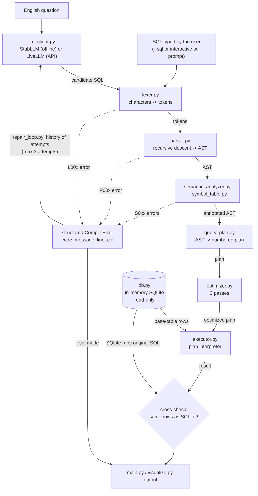
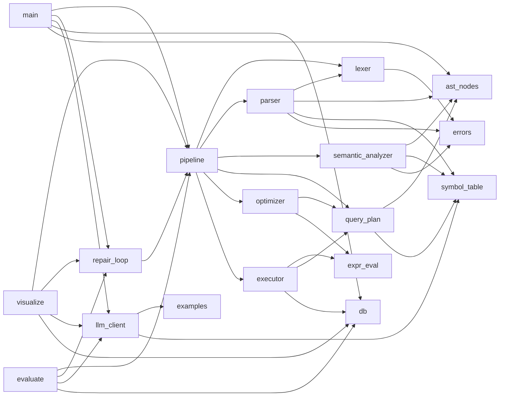

# Architecture

## Overview

The system is a small compiler whose *source language* is SQL written by an
LLM (or typed by a user), and whose *target* is a query plan that a
hand-written interpreter executes. SQLite is used for storage and as an
independent reference to check the interpreter's answers.



## Data flow, stage by stage

| # | Stage | Input -> output | Module | Errors |
|---|-------|-----------------|--------|--------|
| 0 | SQL generation | question + history -> SQL text | `llm_client.py` | `LLMError` (not a compile error) |
| 1 | Lexical analysis | text -> `list[Token]` (type, value, line, col) | `lexer.py` | L001-L004, raised at the first error |
| 2 | Syntax analysis | tokens -> `SelectStatement` AST | `parser.py`, `ast_nodes.py` | P001-P005, raised at the first error |
| 3 | Semantic analysis | AST -> annotated AST (+ errors) | `semantic_analyzer.py`, `symbol_table.py` | S001-S016, all collected |
| 4 | Intermediate code | annotated AST -> `QueryPlan` (tree, printed as `t1 = ...` steps) | `query_plan.py` | - |
| 5 | Optimization | plan -> equivalent plan + per-pass notes | `optimizer.py`, `expr_eval.py` | - |
| 6 | Execution | plan + base tables -> rows | `executor.py`, `expr_eval.py`, `db.py` | - |
| 7 | Verification | interpreter rows vs SQLite rows -> MATCH / MISMATCH | `executor.cross_check` | a mismatch is reported as a bug |

`pipeline.py` runs stages 1-7 for one SQL string and records each stage's
time in milliseconds. `repair_loop.py` wraps stages 0-5: while compilation
fails and attempts remain (maximum 3), it sends the history of failed
attempts back to the LLM.

## Key design decisions

**Hand-written scanner instead of regular expressions.** The lexer walks the
input one character at a time, like a hand-coded finite automaton. This
makes line/column tracking trivial and each token rule easy to explain.

**One parse method per grammar rule.** `parser.py` mirrors `docs/GRAMMAR.md`
rule by rule. Operator precedence comes from the layering of the expression
methods (OR -> AND -> NOT -> predicate -> + - -> * / -> unary -> primary).

**Errors are values with positions.** Every stage reports a `CompileError`
subclass with a stable code. The lexer and parser stop at the first error,
because after a syntax error the rest of the token stream cannot be trusted.
The semantic analyzer collects all errors, because they are independent and
the LLM can then fix them all in one repair.

**Annotated AST.** The semantic analyzer does not just say yes or no: it
writes what it resolved into the tree (`ColumnRef.qualifier`, `sql_type`,
ORDER BY alias links). The planner and interpreter rely on these annotations
and never resolve names again.

**Tree IR, linear display.** The plan is a tree of operators (easy to rewrite
with recursive optimizer passes). It is linearized post-order into numbered
three-address steps for printing and execution, so every step only refers
to temporaries computed before it.

**One expression evaluator.** `expr_eval.evaluate` is used by both the
interpreter (at run time) and the optimizer (constant folding at compile
time). Folding therefore cannot change a result.

**Differential testing against SQLite.** Every executed query is also run by
SQLite, and the results are compared. The comparison is a multiset
comparison when there is no ORDER BY; with ORDER BY the order must match,
but rows that tie on every sort key may appear in any order. This turns
SQLite into a test oracle for the interpreter, which is how the test suite
checks 52 corpus queries.

**Defense in depth for safety.** Only SELECT can be parsed (P002). Only
validated SQL ever reaches SQLite. `db.run_query` refuses text that does not
start with SELECT. The connection itself is read-only (`PRAGMA query_only`).

**The LLM is a plug-in.** `repair_loop.run_repair_loop(question, llm)`
accepts any object with `generate(question, history)`. The offline
`StubLLM`, the `LiveLLM`, and the fake LLMs in the tests are interchangeable.
This is what makes the whole system demoable without an API key.

## Module dependencies



Each compiler module can be imported and used on its own, for example:

```python
from lexer import tokenize
from parser import parse
from semantic_analyzer import analyze

ast = parse(tokenize("SELECT title FROM Books"))
errors = analyze(ast)      # [] means valid
```

## Module descriptions

* **`lexer.py`**: `Lexer.tokenize()` loops over characters. Each `read_*`
  method recognizes one token class: words (keyword or identifier), numbers,
  strings with `''` escapes, quoted identifiers. Two-character operators use
  maximal munch. Unsupported statement keywords (DROP, DELETE, ...) are still
  recognized, so the parser can give a precise P002 error.
* **`parser.py`**: a recursive-descent `Parser` with `peek / advance / match /
  expect` helpers. `expect()` produces "Expected X but found Y" errors. A
  depth counter rejects pathological nesting (P005) before it can exhaust
  Python's recursion limit.
* **`ast_nodes.py`**: dataclasses for expressions and clauses; `walk`,
  `children` and `map_children` for traversal and rewriting; `to_sql` /
  `statement_to_sql` print an AST back to SQL with minimal parentheses;
  `statement_tree` builds the display tree.
* **`symbol_table.py`**: the catalog (`SCHEMA`), a per-query `Scope` mapping
  aliases to tables, and an edit-distance based `closest_match` for hints.
* **`semantic_analyzer.py`**: `Analyzer.run()` builds the scope, type-checks
  every expression with one recursive `check_expr`, and then applies the
  grouping and ORDER BY rules.
* **`query_plan.py`**: `build_plan()` emits SCAN/JOIN (left-deep), FILTER,
  AGGREGATE, HAVING, SORT, PROJECT, DISTINCT and LIMIT nodes. Each node knows
  its output column keys statically.
* **`optimizer.py`**: three passes, each a recursive tree rewrite returning
  notes on what changed. `optimize()` never mutates its input.
* **`expr_eval.py`**: SQL value semantics: three-valued logic, NULL
  propagation, SQLite integer division, the IN list rule, and a dynamic
  programming LIKE matcher.
* **`executor.py`**: executes steps in order with a dictionary of temporaries.
  It uses a nested-loop join, hash grouping and a stable multi-key sort, and
  provides `cross_check()`.
* **`llm_client.py`**, **`repair_loop.py`**: see "The LLM is a plug-in" above.
* **`main.py`**, **`visualize.py`**, **`evaluate.py`**: presentation and
  measurement. These contain no compiler logic.
